### What do you think about a partnership? You are Full-stack (Python + Next.js).

# Hi 👋🏼 I'm Denis Korolev. My name in online is Workaholic.

*Note: First , I want say what — my a conversational English is very bad.\
Bad I can a read and write text (it’s comments of code and documentation of code) or chatting with teams. It’s all very free.
More information about me, you can see in my file. Below, You can see the links on the resume.\
I hope, your team will help me and pull up me.* 

### Django

|||
|:---|:---|
|[DRF](https://www.django-rest-framework.org/)|[django-rest-framework-jwt](https://django-rest-framework-simplejwt.readthedocs.io/en/latest/)|
|[django-rest-auth](https://www.django-rest-framework.org/api-guide/authentication/)|[pytest-django](https://pypi.org/project/pytest-django/)|
|[django-bootstrap4](https://pypi.org/project/django-bootstrap4/)|[django-cors-headers](https://pypi.org/project/django-cors-headers/)|
|[adrf](https://pypi.org/project/adrf/)|[django-webpack-loader](https://pypi.org/project/django-webpack-loader/)|
|[wagtail](https://wagtail.org/)||
|||

## Contacts
||                                                   |
|:----|:--------------------------------------------------|
|[Telegram](https://t.me/Trydogolik)| [kwork profile](https://kwork.ru/user/workaholik) |
|[linkedin](https://www.linkedin.com/in/денис-королев-183ba165/)|[freelance profile](https://freelance.ru/Trydogolik)|

**i'm use**: \

 

**Languages and Tools**: \

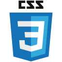
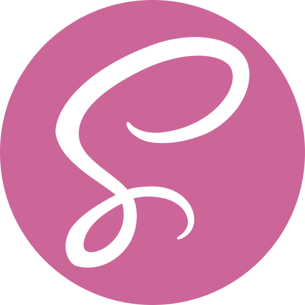

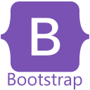

## My skills:
- Languages: SCSS, HTML, JS. Python;
- OS: Windows & Ubuntu. even the bash;
- DB: PostgreSQL, SQLite;
- WF: Django (priority), DRF, ADRF,  FastAPI,  React, React Router, Redux, tailwind, daisyui, Bootstrap;
- HTML, CSS, SCSS;
- else: webpack, package.json,  bable;
- and even: REST API, WebSocket,  SSE, http methods;
- Git, Figm & PSD files.
Installers: pip, poetry, npm, yarn.
- IDE: VSCode, PyCharm, Notepad++, Photoshop, Postman.
- security and clear code. + Little DevTols.

          

**Electronic certificates**: \
<a href="./Osnovy_Python.png" target="_blank">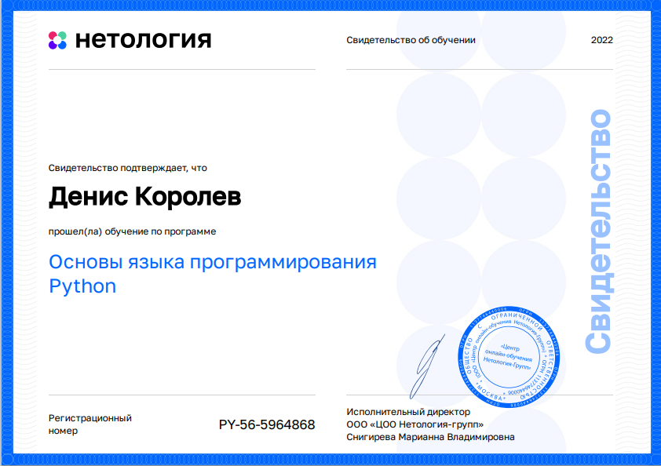</a>
<a href="./Netologe_profassional_Python.png" target="_blank">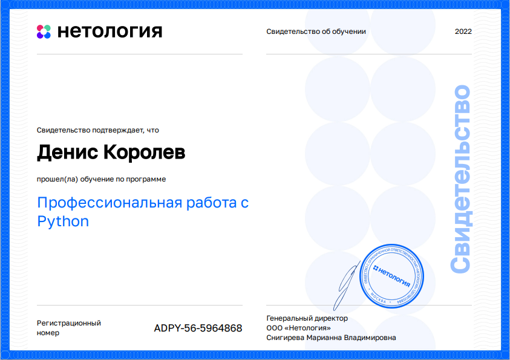</a>
<a href="./netologe_db_python.png" target="_blank">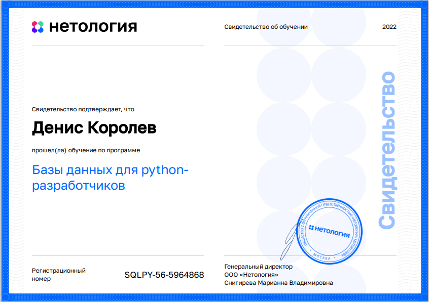</a> \
<a href="./Netologe_html_css.png" target="_blank">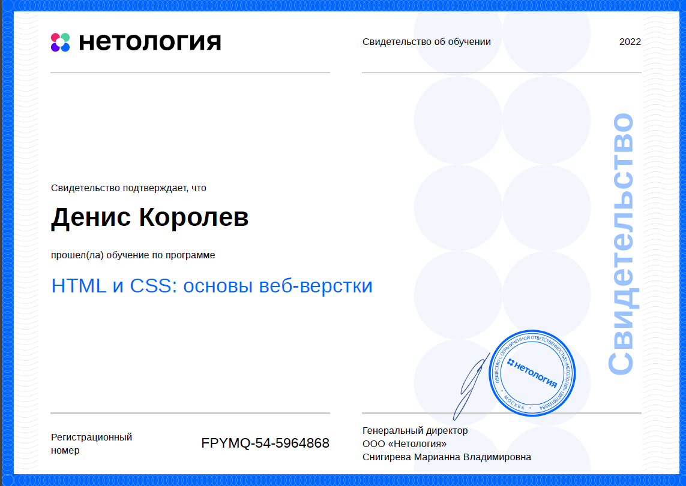</a> 
<a href="./Netologe_JavaScript.png" target="_blank">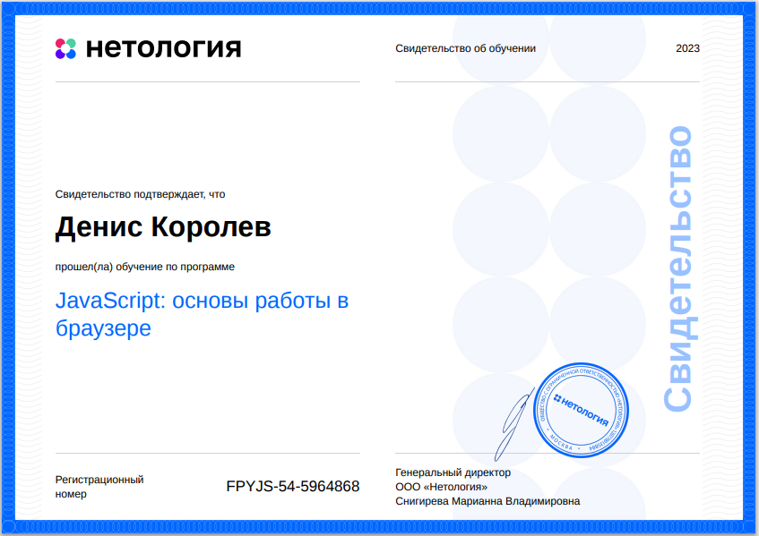</a> 
<a href="./Netologe_JavaScript_browsers.png" target="_blank">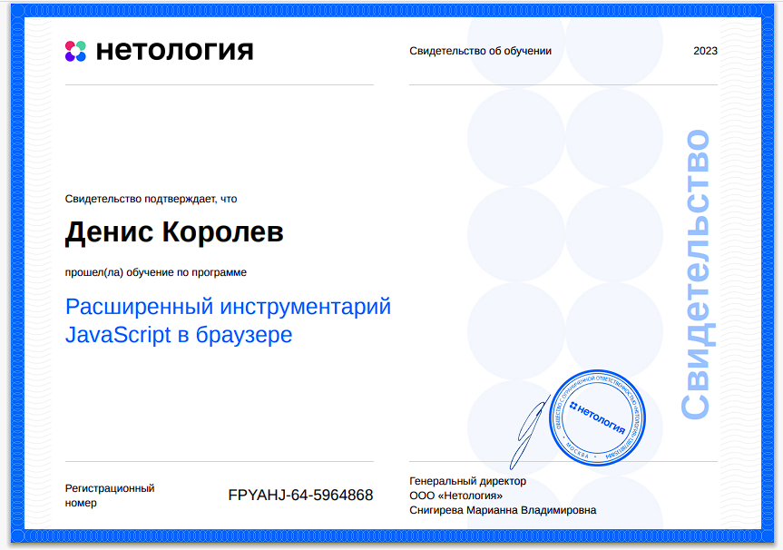</a> \
<a href="./Netologe_JavaScript_midle.png" target="_blank">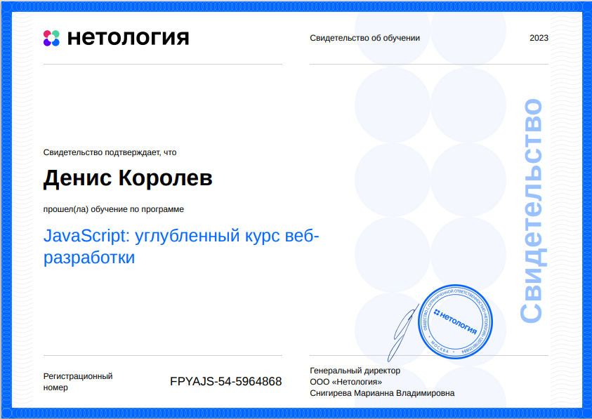</a> 
<a href="./Netologe_web-interface_Django.png" target="_blank">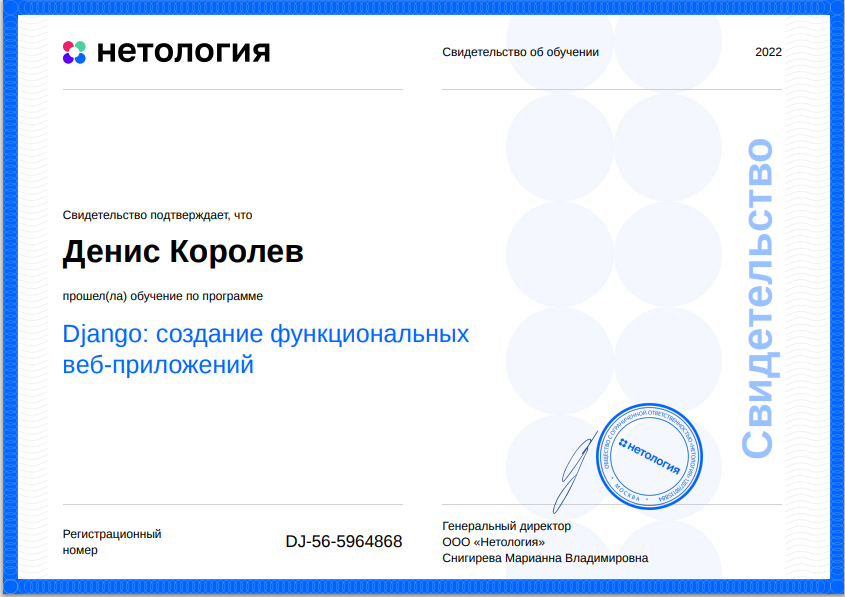</a> 

